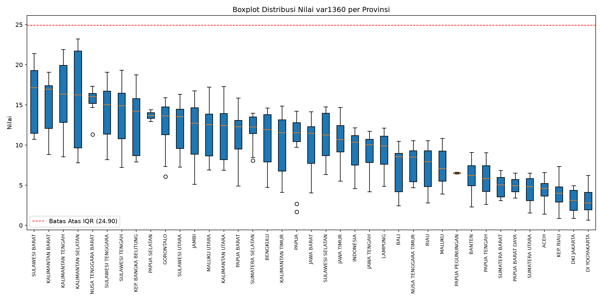
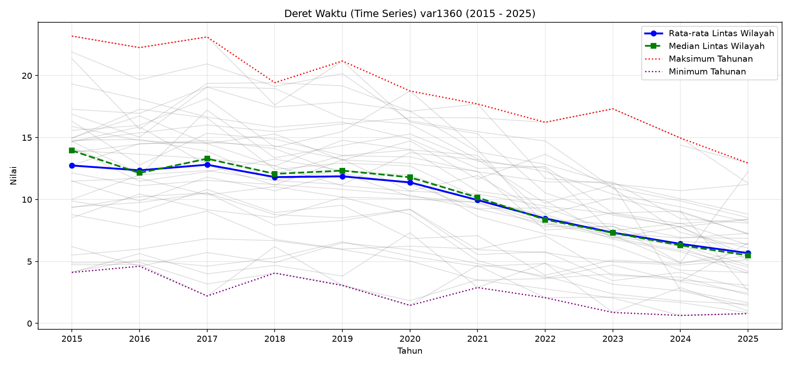
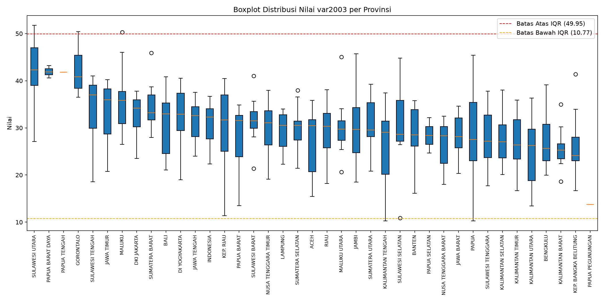
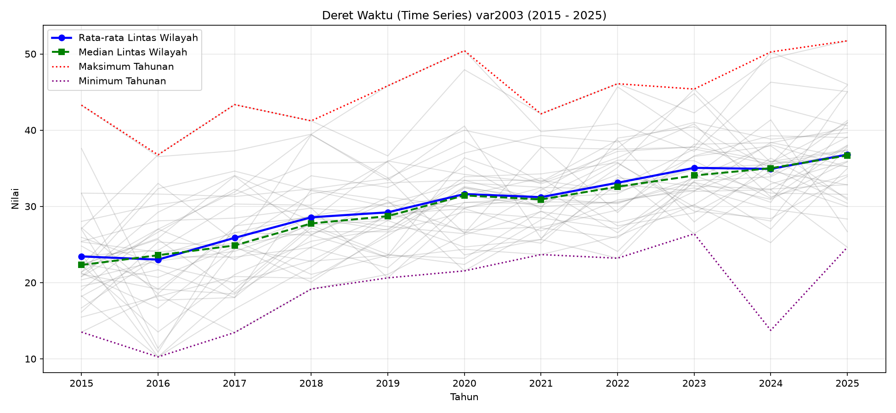

# Profil dan Calon Anomali Seri Utama (`var1360`, `var2003`)

Dokumen ini berisi hasil *profiling* tahap pembersihan (Sprint 1 — Tugas #5) terhadap dua seri utama BPS tanpa melakukan modifikasi data mentah.

## 1. Ringkasan Statistik Deskriptif per Seri

| Seri    |   Total Baris |   Valid |   Missing |   Jumlah Wilayah | Rentang Tahun   | Turvar    |   Mean |   Std |   Min |    Q1 |   Median |     Q3 |   Max |   IQR |   Batas Bawah IQR |   Batas Atas IQR |
|:--------|--------------:|--------:|----------:|-----------------:|:----------------|:----------|-------:|------:|------:|------:|---------:|-------:|------:|------:|------------------:|-----------------:|
| var1360 |           393 |     393 |         0 |               39 | 2015 - 2025     | Tidak ada |  9.99  | 4.86  |  0.64 |  6    |     9.89 | 13.56  | 23.19 | 7.56  |            -5.34  |           24.9   |
| var2003 |           391 |     391 |         0 |               39 | 2015 - 2025     | Tidak ada | 30.335 | 7.341 | 10.25 | 25.46 |    30.5  | 35.255 | 51.72 | 9.795 |            10.768 |           49.947 |

---

## 2. Analisis Seri `var1360`

### Visualisasi Grafik `var1360`

### Calon Anomali Terdeteksi (`var1360`)

_Tidak ditemukan calon anomali berdasarkan kriteria IQR (1.5x) maupun |Z-score| > 3._

### Statistik Deskriptif per Provinsi (`var1360`)

|   wilayah_id | wilayah              |   count |   missing |   mean |   std |   min |    q1 |   median |    q3 |   max |
|-------------:|:---------------------|--------:|----------:|-------:|------:|------:|------:|---------:|------:|------:|
|         1100 | ACEH                 |      11 |         0 |   4.35 |  1.46 |  1.39 |  3.66 |     4.62 |  5.2  |  6.59 |
|         1200 | SUMATERA UTARA       |      11 |         0 |   4.38 |  1.78 |  1.54 |  3.09 |     4.82 |  5.84 |  6.5  |
|         1300 | SUMATERA BARAT       |      11 |         0 |   4.88 |  1.39 |  3.08 |  3.56 |     5.03 |  5.98 |  6.83 |
|         1400 | RIAU                 |      11 |         0 |   6.98 |  2.74 |  2.78 |  4.84 |     7.93 |  9.3  | 10.52 |
|         1500 | JAMBI                |      11 |         0 |  11.65 |  3.82 |  5.1  |  8.86 |    12.71 | 14.64 | 16.74 |
|         1600 | SUMATERA SELATAN     |      11 |         0 |  11.96 |  2.03 |  8.09 | 11.42 |    12.24 | 13.48 | 13.95 |
|         1700 | BENGKULU             |      11 |         0 |  10.81 |  3.57 |  4.71 |  7.9  |    11.93 | 13.78 | 14.61 |
|         1800 | LAMPUNG              |      11 |         0 |   9.23 |  2.51 |  4.87 |  7.62 |     9.88 | 11.09 | 12.1  |
|         1900 | KEP. BANGKA BELITUNG |      11 |         0 |  13.23 |  4.14 |  7.91 |  8.67 |    14.22 | 15.78 | 18.76 |
|         2100 | KEP. RIAU            |      11 |         0 |   3.83 |  1.89 |  0.88 |  2.89 |     4    |  4.78 |  7.31 |
|         3100 | DKI JAKARTA          |      11 |         0 |   3    |  1.47 |  0.86 |  1.88 |     3.12 |  4.37 |  4.93 |
|         3200 | JAWA BARAT           |      11 |         0 |  10.07 |  3.31 |  4.03 |  7.72 |    11.47 | 12.28 | 14.14 |
|         3300 | JAWA TENGAH          |      11 |         0 |   9.14 |  2.38 |  4.2  |  7.81 |    10.05 | 10.7  | 11.72 |
|         3400 | DI YOGYAKARTA        |      11 |         0 |   2.96 |  1.73 |  0.64 |  1.94 |     2.78 |  4.12 |  6.2  |
|         3500 | JAWA TIMUR           |      11 |         0 |  10.61 |  2.64 |  5.49 |  9.16 |    10.67 | 12.42 | 14.68 |
|         3600 | BANTEN               |      11 |         0 |   6.15 |  2.13 |  2.3  |  4.93 |     6.23 |  7.43 |  9.06 |
|         5100 | BALI                 |      11 |         0 |   6.81 |  2.97 |  2.44 |  4.19 |     8.52 |  8.98 | 10.45 |
|         5200 | NUSA TENGGARA BARAT  |      11 |         0 |  15.52 |  1.59 | 11.31 | 15.17 |    16.02 | 16.41 | 17.32 |
|         5300 | NUSA TENGGARA TIMUR  |      11 |         0 |   7.55 |  2.26 |  4.7  |  5.42 |     8.51 |  9.28 | 10.53 |
|         6100 | KALIMANTAN BARAT     |      11 |         0 |  14.78 |  3.55 |  8.82 | 12.06 |    16.95 | 17.37 | 19.07 |
|         6200 | KALIMANTAN TENGAH    |      11 |         0 |  16.15 |  4.69 |  8.53 | 12.83 |    16.35 | 19.92 | 21.9  |
|         6300 | KALIMANTAN SELATAN   |      11 |         0 |  15.85 |  6.16 |  7.8  |  9.64 |    16.24 | 21.72 | 23.19 |
|         6400 | KALIMANTAN TIMUR     |      11 |         0 |   9.98 |  4.04 |  4.11 |  6.76 |    11.54 | 13.13 | 14.85 |
|         6500 | KALIMANTAN UTARA     |      11 |         0 |  11.56 |  3.76 |  6.86 |  8.19 |    12.42 | 13.93 | 17.29 |
|         7100 | SULAWESI UTARA       |      11 |         0 |  12.33 |  3.03 |  7.25 |  9.56 |    13.54 | 14.44 | 16.32 |
|         7200 | SULAWESI TENGAH      |      11 |         0 |  13.76 |  4.02 |  7.2  | 10.78 |    14.89 | 16.45 | 19.32 |
|         7300 | SULAWESI SELATAN     |      11 |         0 |  11    |  3.06 |  6.33 |  8.67 |    11.25 | 13.95 | 14.76 |
|         7400 | SULAWESI TENGGARA    |      11 |         0 |  14.19 |  3.76 |  8.19 | 11.34 |    15.03 | 16.72 | 19.08 |
|         7500 | GORONTALO            |      11 |         0 |  12.54 |  3.26 |  6.08 | 11.28 |    13.65 | 14.74 | 15.9  |
|         7600 | SULAWESI BARAT       |      11 |         0 |  15.88 |  3.98 | 10.71 | 11.48 |    17.12 | 19.27 | 21.37 |
|         8100 | MALUKU               |      11 |         0 |   7.44 |  2.33 |  3.89 |  5.51 |     7.08 |  9.26 | 10.81 |
|         8200 | MALUKU UTARA         |      11 |         0 |  11.75 |  3.48 |  6.88 |  8.65 |    12.52 | 13.86 | 17.21 |
|         9100 | PAPUA BARAT          |      11 |         0 |  11.4  |  3.31 |  4.9  |  9.51 |    12.27 | 13.06 | 15.86 |
|         9200 | PAPUA BARAT DAYA     |       2 |         0 |   4.94 |  2.18 |  3.4  |  4.17 |     4.94 |  5.72 |  6.49 |
|         9400 | PAPUA                |      11 |         0 |  10.32 |  4.23 |  1.67 | 10.44 |    11.52 | 12.78 | 14.2  |
|         9500 | PAPUA SELATAN        |       2 |         0 |  13.67 |  1.03 | 12.94 | 13.3  |    13.67 | 14.04 | 14.4  |
|         9600 | PAPUA TENGAH         |       2 |         0 |   5.84 |  4.54 |  2.63 |  4.24 |     5.84 |  7.44 |  9.05 |
|         9700 | PAPUA PEGUNUNGAN     |       2 |         0 |   6.5  |  0.13 |  6.41 |  6.46 |     6.5  |  6.55 |  6.6  |
|         9999 | INDONESIA            |      11 |         0 |   9.26 |  2.54 |  4.56 |  7.49 |    10.35 | 11.16 | 12.14 |

---

## 2. Analisis Seri `var2003`

### Visualisasi Grafik `var2003`

### Calon Anomali Terdeteksi (`var2003`)

Ditemukan **5** baris calon anomali:

| Seri    | Wilayah           | Turvar    |   Periode |   Nilai |   Z-Score | Alasan Ditandai             |
|:--------|:------------------|:----------|----------:|--------:|----------:|:----------------------------|
| var2003 | KALIMANTAN TENGAH | Tidak ada |      2016 |   10.25 |     -2.74 | Outlier bawah IQR (< 10.77) |
| var2003 | SULAWESI UTARA    | Tidak ada |      2025 |   51.72 |      2.91 | Outlier atas IQR (> 49.95)  |
| var2003 | GORONTALO         | Tidak ada |      2020 |   50.43 |      2.74 | Outlier atas IQR (> 49.95)  |
| var2003 | MALUKU            | Tidak ada |      2024 |   50.26 |      2.71 | Outlier atas IQR (> 49.95)  |
| var2003 | PAPUA             | Tidak ada |      2016 |   10.25 |     -2.74 | Outlier bawah IQR (< 10.77) |

### Statistik Deskriptif per Provinsi (`var2003`)

|   wilayah_id | wilayah              |   count |   missing |   mean |    std |   min |    q1 |   median |    q3 |   max |
|-------------:|:---------------------|--------:|----------:|-------:|-------:|------:|------:|---------:|------:|------:|
|         1100 | ACEH                 |      11 |         0 |  26.79 |   6.92 | 15.47 | 20.68 |    30.48 | 31.76 | 35.84 |
|         1200 | SUMATERA UTARA       |      11 |         0 |  31.04 |   5.65 | 20.82 | 28.12 |    29.52 | 35.34 | 39.26 |
|         1300 | SUMATERA BARAT       |      11 |         0 |  34.58 |   4.9  | 27.96 | 31.68 |    33.22 | 36.98 | 45.89 |
|         1400 | RIAU                 |      11 |         0 |  29.17 |   5.78 | 18.19 | 25.77 |    30.36 | 33.06 | 38.09 |
|         1500 | JAMBI                |      11 |         0 |  29.87 |   8.19 | 18.5  | 24.74 |    29.66 | 34.28 | 45.68 |
|         1600 | SUMATERA SELATAN     |      11 |         0 |  29.67 |   4.98 | 21.4  | 27.4  |    30.5  | 31.4  | 37.94 |
|         1700 | BENGKULU             |      11 |         0 |  27.19 |   5.88 | 19.98 | 23.04 |    25.66 | 30.75 | 39.1  |
|         1800 | LAMPUNG              |      11 |         0 |  29.3  |   4.13 | 22.31 | 26.06 |    30.55 | 32.76 | 33.98 |
|         1900 | KEP. BANGKA BELITUNG |      11 |         0 |  26.13 |   6.71 | 16.65 | 23    |    24.09 | 28.04 | 41.35 |
|         2100 | KEP. RIAU            |      11 |         0 |  30.43 |   8.69 | 11.38 | 25.03 |    31.7  | 36.98 | 40.45 |
|         3100 | DKI JAKARTA          |      11 |         0 |  32.52 |   4.94 | 23.51 | 30.24 |    34.19 | 35.94 | 37.81 |
|         3200 | JAWA BARAT           |      11 |         0 |  28.38 |   4.6  | 20.36 | 25.77 |    28.17 | 32.13 | 34.6  |
|         3300 | JAWA TENGAH          |      11 |         0 |  31.51 |   4.78 | 23.99 | 28.12 |    32.58 | 34.48 | 37.52 |
|         3400 | DI YOGYAKARTA        |      11 |         0 |  32.43 |   6.48 | 19.02 | 29.45 |    32.87 | 37.37 | 40.54 |
|         3500 | JAWA TIMUR           |      11 |         0 |  33.41 |   6.45 | 20.77 | 28.66 |    35.92 | 38.25 | 40.24 |
|         3600 | BANTEN               |      11 |         0 |  28.83 |   5.69 | 16.13 | 26.1  |    28.48 | 33.9  | 35.76 |
|         5100 | BALI                 |      11 |         0 |  30.66 |   6.58 | 21.08 | 24.53 |    32.96 | 35.26 | 40.82 |
|         5200 | NUSA TENGGARA BARAT  |      11 |         0 |  26.57 |   5.16 | 18.04 | 22.49 |    28.34 | 30.29 | 32.45 |
|         5300 | NUSA TENGGARA TIMUR  |      11 |         0 |  29.68 |   6.02 | 19.13 | 26.39 |    31.05 | 33.65 | 37.95 |
|         6100 | KALIMANTAN BARAT     |      11 |         0 |  25.61 |   4.26 | 18.65 | 23.46 |    25.25 | 26.64 | 34.98 |
|         6200 | KALIMANTAN TENGAH    |      11 |         0 |  26.26 |   8.51 | 10.25 | 20.17 |    29.03 | 31.45 | 37.42 |
|         6300 | KALIMANTAN SELATAN   |      11 |         0 |  27.41 |   5.41 | 20.07 | 23.61 |    27.07 | 30.62 | 38.03 |
|         6400 | KALIMANTAN TIMUR     |      11 |         0 |  27.3  |   5.95 | 16.68 | 23.37 |    26.4  | 31.73 | 35.91 |
|         6500 | KALIMANTAN UTARA     |      11 |         0 |  24.24 |   7.57 | 13.45 | 18.78 |    26.27 | 29.75 | 36.32 |
|         7100 | SULAWESI UTARA       |      11 |         0 |  42.24 |   6.94 | 27.09 | 38.99 |    42.27 | 47.01 | 51.72 |
|         7200 | SULAWESI TENGAH      |      11 |         0 |  33.98 |   7.03 | 18.54 | 29.88 |    37.01 | 39.06 | 41.02 |
|         7300 | SULAWESI SELATAN     |      11 |         0 |  30.69 |   9.07 | 10.86 | 27.17 |    28.6  | 35.84 | 44.79 |
|         7400 | SULAWESI TENGGARA    |      11 |         0 |  28.08 |   7.03 | 17.68 | 23.7  |    27.18 | 32.7  | 37.8  |
|         7500 | GORONTALO            |      11 |         0 |  42    |   4.5  | 36.52 | 38.38 |    40.84 | 45.44 | 50.43 |
|         7600 | SULAWESI BARAT       |      11 |         0 |  31.5  |   4.9  | 21.35 | 29.94 |    31.49 | 33.48 | 41    |
|         8100 | MALUKU               |      11 |         0 |  36.09 |   7.21 | 26.47 | 30.89 |    35.8  | 37.75 | 50.26 |
|         8200 | MALUKU UTARA         |      11 |         0 |  30.06 |   6.12 | 20.62 | 27.32 |    29.75 | 31.49 | 45.01 |
|         9100 | PAPUA BARAT          |      11 |         0 |  27.84 |   6.68 | 13.52 | 23.86 |    31.58 | 32.66 | 34.86 |
|         9200 | PAPUA BARAT DAYA     |       2 |         0 |  41.9  |   1.87 | 40.57 | 41.23 |    41.9  | 42.56 | 43.22 |
|         9400 | PAPUA                |      11 |         0 |  28.37 |  10.21 | 10.25 | 23.04 |    27.52 | 35.43 | 45.39 |
|         9500 | PAPUA SELATAN        |       2 |         0 |  28.4  |   5.32 | 24.64 | 26.52 |    28.4  | 30.28 | 32.16 |
|         9600 | PAPUA TENGAH         |       1 |         0 |  41.83 | nan    | 41.83 | 41.83 |    41.83 | 41.83 | 41.83 |
|         9700 | PAPUA PEGUNUNGAN     |       1 |         0 |  13.74 | nan    | 13.74 | 13.74 |    13.74 | 13.74 | 13.74 |
|         9999 | INDONESIA            |      11 |         0 |  30.6  |   4.8  | 22.32 | 27.66 |    32.26 | 34.05 | 36.68 |

---

## 3. Catatan Temuan Kualitas Data (Untuk Tahap Silver)

1. **Agregat Nasional Tercampur (`wilayah_id = 9999`):** Entitas `INDONESIA` (11 baris per seri) berada dalam kolom `wilayah` yang sama dengan 38 provinsi sehingga perlu dipisahkan saat agregasi tingkat provinsi pada tahap Silver.
2. **Ketidaklengkapan Periode Provinsi Pemekaran Papua:** Provinsi hasil pemekaran (`PAPUA BARAT DAYA`, `PAPUA SELATAN`, `PAPUA TENGAH`, `PAPUA PEGUNUNGAN`) hanya memiliki 1–2 tahun observasi terbaru. Khusus `PAPUA TENGAH` dan `PAPUA PEGUNUNGAN`, masing-masing hanya memiliki 1 observasi pada `var2003` (dibandingkan 2 observasi pada `var1360`), yang menyebabkan perbedaan total baris (`393` vs `391`).
3. **Evaluasi Calon Anomali (`var2003`):**
   - Kelima titik yang ditandai pada `var2003` melewati batas pagar IQR ($10.77$ dan $49.95$), namun tidak ada satu pun yang melewati batas ekstrem $|Z\text{-score}| > 3$ (maksimum $|z| = 2.91$ pada Sulawesi Utara 2025).
   - Kalimantan Tengah (2016) dan Papua (2016) memiliki nilai identik persis (`10.25`) yang berada tepat di bawah batas bawah IQR (`10.77`), sehingga perlu diverifikasi terhadap metadata/sumber asli BPS sebelum diputuskan apakah dipertahankan sebagai variasi alami atau ditandai.
4. **Metadata Satuan Kosong pada `var2003`:** Kolom `satuan` pada `sdg5_5_5_2_v2003.csv` bernilai kosong (`NaN`), berbeda dengan `sdg5_5_3_1_v1360.csv` yang terisi `Persen`.